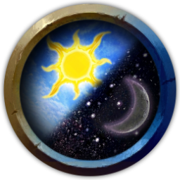

  
    
  <h1>Duskfall</h1>
  <b>By Dukul</b>

Gamma, brightness and contrast that follow you through the world. Duskfall sets the game's
Gamma, Brightness, Contrast and Bloom for where you are and what you are doing, and moves
between them smoothly, the way your eyes adjust when you walk from sunlight into a cave.

For WoW Forever. Early development: not released yet.

## What it does

- **Places, found as you play.** Every subzone, zone and instance you visit is listed. A place is
  off until you give it a Look, so nothing changes until you want it to.
- **Looks.** A Look is a set of values (as offsets from your own settings, or fixed values) for
  one or more places, optionally only indoors or outdoors, at dawn, day, dusk or night (or your
  own hours), in combat, mounted, swimming, underwater, resting or as a ghost. The most specific
  Look wins, and each value it leaves unset falls through to the next one.
- **Styles.** A named set of Looks with its own transition: Instant, Fade, or Adapt, eye
  adaptation with a short dip when it gets darker and a short glare when it gets brighter.
  Every character uses one Style, all of them can share one, and a Look can be for every
  character or only the ones you pick.
- **A live editor.** Changes show on your screen while you drag the slider, Preview shows a Look
  anywhere, and Revert undoes what you changed.
- **Your settings stay yours.** Logging out or switching Duskfall off puts your own values
  back. Moving one of the game's sliders yourself is kept while you stay where you are.
- **Out of the way.** The minimap's day and night moon opens Duskfall. A minimap button shows
  up when another addon hides the moon. Duskfall is also in the addon compartment and on broker
  bars, and there is a key binding to switch it on and off. An optional floating display shows
  the Look in effect when it changes.

## Commands

`/dusk` (or `/duskfall`, `/df`) opens the window. `/dusk help` lists everything else: `status`,
`on` / `off`, `save` / `clear` / `looks` for quick Looks from chat, `style`, `mode`, `fade`,
`adapt`, `baseline` and more.

---

Duskfall is a free fan project by Dukul, made for fun and never for money. It is not affiliated with, endorsed by or sponsored by Blizzard Entertainment. World of Warcraft, Warcraft and Blizzard Entertainment are trademarks or registered trademarks of Blizzard Entertainment, Inc. All other trademarks belong to their owners.
